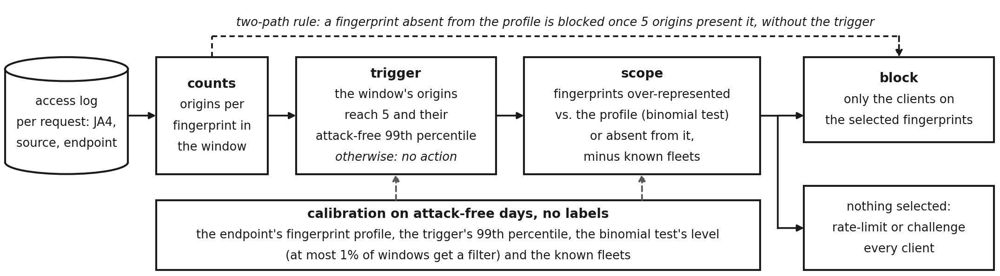
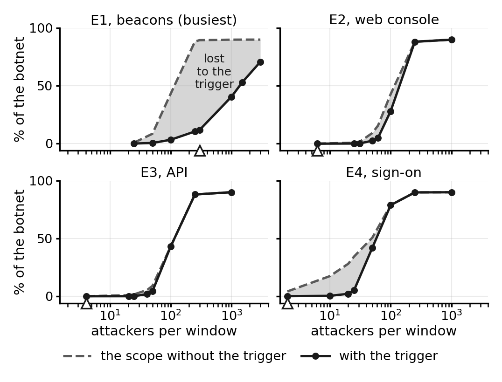

# Reading the figures

This guide follows the [current manuscript](../papers/http-session-noms/article.tex). The paper has two figures; [Tables I–VIII have a separate guide](tables.md). An **origin** is an address–fingerprint pair, and each window lasts five minutes.

## Figure 1 — From access logs to selective filtering

**Question:** When does the system act, and which clients does it affect?

Read the solid path from left to right. Access logs supply the endpoint, source address and JA4 fingerprint. Counts summarize origins per fingerprint. The origin trigger checks whether the window reaches both five origins and its calibrated volume threshold. Once it fires, the primary scope selects fingerprints over-represented relative to the endpoint profile or absent from it, with known fleets exempted.

A nonempty scope produces a filter affecting clients on those fingerprints. An empty scope invokes the **fallback**, a rate limit or challenge applied to every client. If the primary trigger does not fire, that path takes no action. The lower box supplies the profile, trigger threshold, test level and known fleets from calibration traffic.

The upper dashed route is the exploratory **two-path rule**: a fingerprint absent from the profile can be blocked once five origins present it, even without the volume trigger. The dashed arrows from calibration supply parameters rather than representing that bypass.

**Interpretation:** Trigger and scope answer different questions. A scope may identify a useful fingerprint while the trigger prevents its filter from acting. Removing that requirement can recover coverage, but also exposes legitimate new clients to filtering. The diagram specifies behavior; it does not establish the two-path rule's safety. At E5 its ungated novelty path exceeded the false-alarm budget ([Table VI](tables.md#table-vi--two-real-attacks-at-e5)).

**Source:** [fig1_r48.py](../papers/http-session-noms/figures/fig1_r48.py); method in Section III and configurations in Table II. This is a schematic, not a measured performance plot.

## Figure 2 — Coverage lost while waiting for the trigger

**Question:** How much of an injected botnet can the scope select, and how much does the complete configuration actually stop?

| Visual element | Meaning |
|---|---|
| Four panels | E1 beacons, E2 web console, E3 API and E4 sign-on |
| Horizontal axis, logarithmic | Attackers per five-minute window |
| Vertical axis | Percentage of the botnet blocked, averaged over attack windows |
| Solid line with circles | Primary configuration, with the origin trigger |
| Dashed line | Scope applied without the trigger, a post hoc comparison |
| Gray gap | Coverage lost because the trigger does not fire |
| Triangle below the axis | Attack size equal to one tenth of that endpoint's median window; not a coverage measurement |

The experiments use **25 new stacks on the development days**. Approximately one bot in ten uses a one-off fingerprint, which limits coverage to about 90%. Windows without a trigger firing remain in the coverage denominator.

For example, at E1 a 100-attacker botnet has 3.4% coverage with the trigger and 43.2% without it. At roughly 300 attackers (`0.1×`), these become 11.8% and 89.6%. On the smaller endpoints, 100 attackers already exceed the normal window population, so the calibration floor becomes a more prominent constraint.

**Interpretation:** A trigger can hide useful selection, especially on the busiest endpoint. This figure does not show the false-alarm cost of removing it; read [Table VIII](tables.md#table-viii--scopes-under-different-triggers) alongside it. The 11.8% example belongs to development days; Table V's 2.9% is the prospective result for the same E1 relative attack size. They are different periods. On E1–E3 the dashed line also matches the two-path rule's novelty path in this new-stack scenario; it is not a general measurement of that rule on shared fingerprints.

**Source:** `sweep.fleets` in [production_tables.json](../experiments/sprint-6-noms/results/production_tables.json), plotted by `fig_stops` in [make_figures_en.r13.py](../papers/http-session-noms/figures/make_figures_en.r13.py). The filename `fig6_stops.png` retains an older number.

For commands and dependencies, see [figure regeneration](../papers/http-session-noms/README.md#figures-and-experimental-limits).
